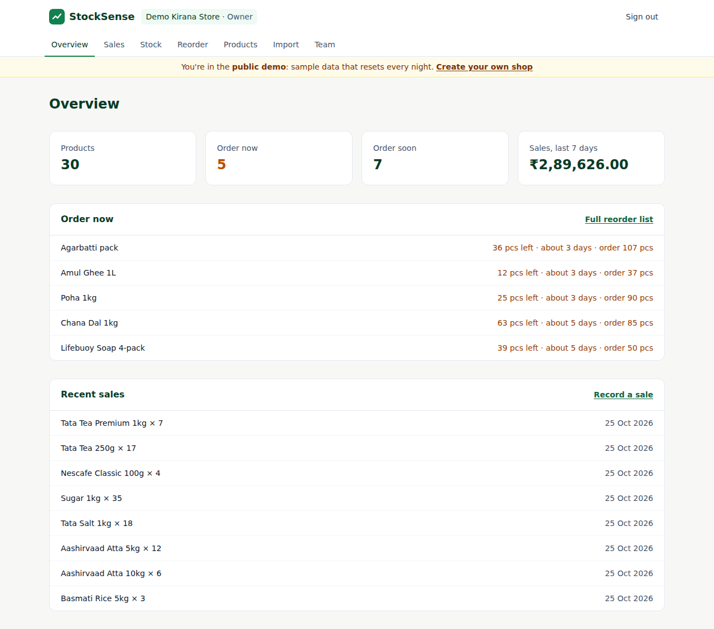
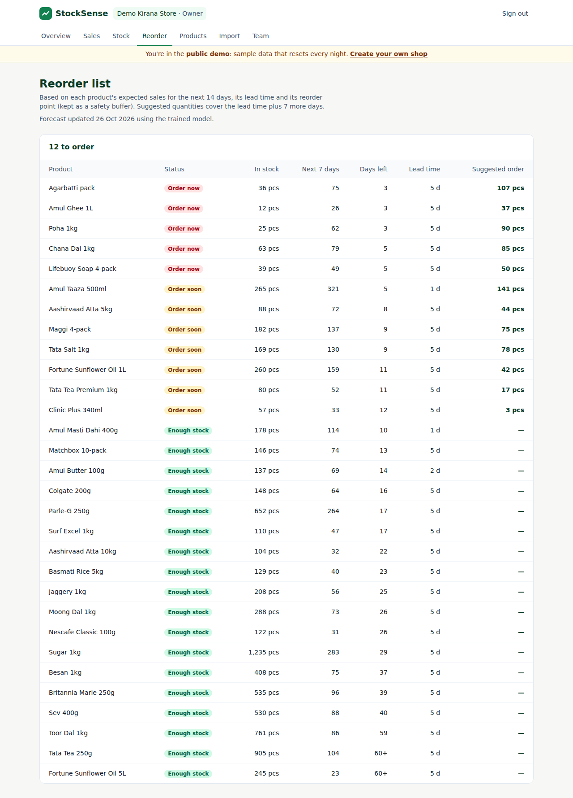
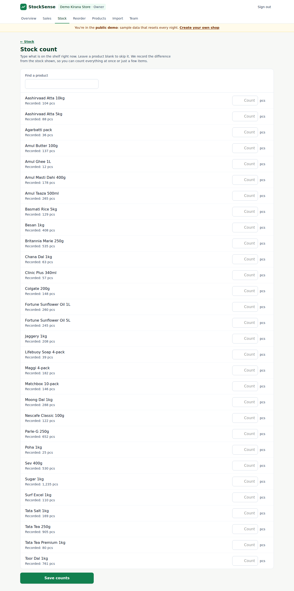
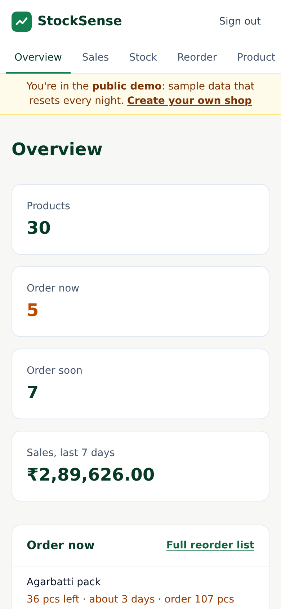
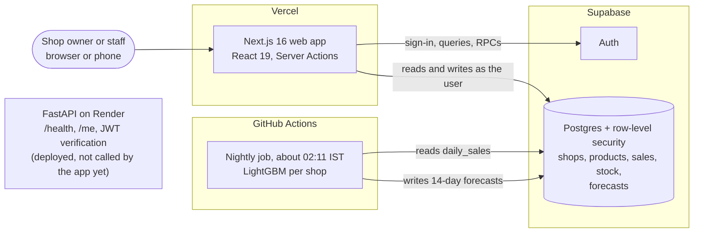

# StockSense

[](https://github.com/EBharadwaj09/stocksense/actions/workflows/ci.yml)

Inventory tracking and demand forecasting for small shops. Owners and staff record stock and sales; StockSense forecasts the next 14 days of demand for every product and lists what to reorder before it runs out.

**Live demo: <https://stocksense-phi-tan.vercel.app>** — tap **Try the live demo** (no sign-up), or log in with:

| Email | Password |
| --- | --- |
| `demo@example.com` | `stocksense-demo-2026` |

The demo is a sample kirana shop with a year of **synthetic** sales. It resets every night, so feel free to record sales, count stock or import a CSV.

<p align="center">
  
</p>

| Reorder list | Stock count | On a phone |
| --- | --- | --- |
|  |  |  |

## What it does

- **Record** sales and stock in seconds (stock is a ledger; a sale lowers it automatically), or **count the shelf** and save only the differences.
- **Import** a year of sales from a CSV. It is validated in the browser, again on the server and again in SQL; bad rows are listed, good rows are imported (the database inserts 10,000 rows in under a second).
- **Forecast** the next 14 days per product with a LightGBM model that knows weekdays, recent demand and festivals.
- **Reorder** list: *Order now* / *Order soon* / *Enough stock*, with days of stock left, supplier lead time and a suggested quantity.
- **Teams**: owners invite staff by email; staff can record sales and stock but not change products, imports or the team.

## Architecture



| Part | Tech | Folder |
| --- | --- | --- |
| Web app | Next.js 16, React 19, TypeScript, Tailwind CSS 4 | `apps/web` |
| Auth and database | Supabase (Auth, Postgres, row-level security) | `supabase` |
| Forecasting | Python 3.12, pandas, LightGBM — see [ml/README.md](ml/README.md) | `ml` |
| API service | Python 3.12, FastAPI, PyJWT. Verifies Supabase tokens; deployed but not used by the web app yet (forecasts do not go through it) | `services/api` |
| CI/CD | GitHub Actions (lint, tests, build, backtest, nightly forecast, screenshots), Vercel, Render | `.github/workflows` |

**Why forecasts run nightly in GitHub Actions and not on the API:** a training run peaks at about 270 MB, the free Render instance has 512 MB, sleeps when idle and has no disk. Precomputing once a night costs nothing and keeps the dashboard instant.

**Security notes**

- Sessions use Supabase's HTTP-only cookies, refreshed on every request by `src/proxy.ts`; protected pages are checked on the server with `getUser()`, never the cookie alone.
- Every table has row-level security, so a user can only read or write data for shops they belong to (tested, see below). The nightly job's secret key lives only in GitHub secrets.
- The API verifies Supabase access tokens itself (JWKS for ES256/RS256), checking signature, issuer, audience and expiry. `alg: none` and unknown algorithms are rejected.
- Login redirects only accept same-site paths. Sign-up and forgot-password show the same message whether or not an email is registered.
- All input is validated on the server with Zod; users see plain-language errors, never internal ones.

## Forecast quality

Rolling-origin backtest: at each of 8 weekly origins the model is retrained on what was known that day and scored on the next 14 days for all 30 products (3,360 forecasts). WAPE = total absolute error / total units sold (lower is better).

| Data | Best simple rule (28-day average) | LightGBM | Improvement |
| --- | ---: | ---: | ---: |
| Sample shop, 1 year | 26.5% | **24.5%** | 7.6% |
| Synthetic shop, 3 years | 25.3% | **21.0%** | 17.1% |

Full tables (MAE, bias, festive days, features) are in [ml/reports/metrics.md](ml/reports/metrics.md), regenerated by `make train` and in CI. A test corrupts the future to prove no feature leaks it.

> **Honest caveat:** both datasets are synthetic. They show the pipeline is correct and beats simple rules on known patterns. Accuracy on a real shop is unknown until real sales history exists.

**Reorder rule** (`apps/web/src/lib/reorder.ts`): *Order now* if stock ≤ forecast demand over the supplier lead time + reorder point; *Order soon* if stock ≤ demand over lead time + 7 days + reorder point; the suggestion tops stock up to the second level.

## Data model and access rules

| Table | Holds | Who can write |
| --- | --- | --- |
| `shops` | One row per shop | Created via `create_shop()`; owners update |
| `shop_members` | User ↔ shop, role `owner` or `staff` | Via `create_shop()` / `accept_invite()`; owners remove staff |
| `shop_invites` | Pending staff invites by email | Owners |
| `products` | Catalogue, reorder point, supplier lead time | Owners |
| `sales` | Sales ledger (manual and imported history) | Members; owners delete |
| `stock_movements` | Stock ledger (opening, purchase, sale, adjustment) | Members; owners delete |
| `forecasts`, `forecast_runs` | 14-day forecast per product, one run record per shop | Nightly job only; members read |
| `product_stock`, `daily_sales` (views) | Current stock; sales per product per day | Read-only |

Sales and stock are append-only ledgers: corrections are new rows, never edits. `record_sale()` writes the sale and its stock decrease in one transaction. `import_sales()` (owners only) adds history for forecasting without changing current stock. Migrations live in `supabase/migrations/`.

## Demo account

The demo is a normal account flagged `app_metadata.demo = true` (only the secret key can set that). Each night the workflow runs `python -m stocksense_ml demo-reset`, which resets its password, calls the SQL function `demo_prepare()` (callable only with the secret key, refuses any non-demo account), reloads the sample year ending yesterday and sets opening stock for a realistic mix of reorder statuses. Visitors cannot change its password, and reset emails are never sent to it.

## Run locally

Requires Node.js 22 and Python 3.12+.

```bash
# Web app
cd apps/web
cp .env.example .env.local      # then fill in your Supabase values
npm install
npm run dev                     # http://localhost:3000

# API (second terminal)
cd services/api
python -m venv .venv && source .venv/bin/activate
pip install -r requirements-dev.txt
cp .env.example .env            # then fill in SUPABASE_URL
uvicorn app.main:app --reload   # http://localhost:8000/docs

# Forecasting
make ml-install && make train   # backtest -> ml/reports/metrics.md
```

## Tests

```bash
cd apps/web && npm run lint && npm test && npm run build && npm run typecheck
cd services/api && ruff check . && pytest
make ml-lint ml-test train      # forecasting: lint, tests, backtest report
```

CI runs all of these on every push and pull request. Database rules are checked in the Supabase SQL editor: `supabase/tests/rls_test.sql` (cross-shop isolation, staff limits, import rules) must end with `ALL_RLS_TESTS_PASSED` and `supabase/tests/demo_test.sql` with `DEMO_TESTS_PASSED`; both run in a transaction that is rolled back.

## Environment variables

| Variable | Where | Purpose |
| --- | --- | --- |
| `NEXT_PUBLIC_SUPABASE_URL` | Vercel | Supabase project URL |
| `NEXT_PUBLIC_SUPABASE_PUBLISHABLE_KEY` | Vercel | Supabase publishable (or legacy anon) key — safe in the browser |
| `NEXT_PUBLIC_API_URL` | Vercel | URL of the Render API (reserved; the app does not call it yet) |
| `SUPABASE_URL` | Render | Same project URL, used to verify tokens |
| `ALLOWED_ORIGINS` | Render | Comma-separated web origins allowed to call the API |
| `SUPABASE_JWT_SECRET` | Render | Only for projects on the legacy JWT secret; otherwise leave empty |
| `SUPABASE_SECRET_KEY` | GitHub Actions secret | Lets the nightly job write forecasts and reset the demo. Never in the web app |

Templates: `apps/web/.env.example`, `services/api/.env.example`. Never commit real values.

## Deploy

1. **Supabase:** create a project and apply `supabase/migrations/` in order. Under *Authentication → URL Configuration*, set *Site URL* to your Vercel URL and add `https://<your-vercel-domain>/auth/callback` to *Redirect URLs*.
2. **Vercel:** import this repo, set *Root Directory* to `apps/web`, add the `NEXT_PUBLIC_*` variables, deploy.
3. **Render:** *New → Blueprint*, pick this repo (uses `render.yaml`), fill in `SUPABASE_URL` and `ALLOWED_ORIGINS`.
4. **GitHub:** add the `SUPABASE_SECRET_KEY` repository secret (Supabase → Project Settings → API Keys). The *Nightly forecast* workflow then runs daily and can be started by hand from the Actions tab.
5. Check: sign up on the Vercel URL, confirm the email, land on the dashboard; `https://<render-url>/health` returns `{"status":"ok"}`.

## Limitations

- **No real shop data yet.** All accuracy numbers come from synthetic sales; real-world accuracy is unproven.
- **Forecasts are nightly**, not live: a sale recorded now changes stock immediately but affects the forecast the next morning. Products with under 60 days of history get a 28-day average instead of the model.
- **Festival calendar** (`ml/stocksense_ml/festivals.csv`) covers Gujarat-relevant festivals for 2024–2027 and needs next years' dates added.
- **One shop per account in the app** (the database allows more), no barcode scanning, no point-of-sale or accounting integration, no purchase-order tracking: suggested orders are advice, received stock is entered on the Stock page.
- **Free-tier infrastructure:** Supabase's built-in email sender allows only a few emails per hour (set up custom SMTP before real users), and the free Render API sleeps when idle, so its first request can take up to a minute.

## Roadmap

| Milestone | Scope | Status |
| --- | --- | --- |
| M1 Template | Monorepo, CI, deploy pipeline, auth | Done |
| M2 Core app | Shops, roles, products, stock, sales, CSV import | Done |
| M3 Model | Baselines + LightGBM, backtests, reproducible training ([metrics](ml/reports/metrics.md)) | Done |
| M4 Serving | Nightly forecasts (GitHub Actions → Supabase), reorder list | Done |
| M5 Release | Stock count, password reset, demo, README, real-data benchmark, end-to-end tests, mobile and accessibility pass | In progress |

## License

MIT — see [LICENSE](LICENSE).
